# Kairos Architecture

This document explains how Kairos is organized, how a request travels through the system, and why the main design decisions were made. For setup instructions and the API reference, see the [README](../README.md).

## Table of Contents

1. [Overview](#1-overview)
2. [System Context](#2-system-context)
3. [Solution Layout](#3-solution-layout)
4. [Modular Monolith](#4-modular-monolith)
5. [Request Pipeline](#5-request-pipeline)
6. [Core Building Blocks](#6-core-building-blocks)
7. [Transactions and the Inbox Pattern](#7-transactions-and-the-inbox-pattern)
8. [Persistence](#8-persistence)
9. [Authentication and Authorization](#9-authentication-and-authorization)
10. [Application Bootstrap](#10-application-bootstrap)
11. [State Machines](#11-state-machines)
12. [Observability](#12-observability)
13. [Testing Architecture](#13-testing-architecture)
14. [Adding a New Feature](#14-adding-a-new-feature)
15. [Design Trade-offs and Future Work](#15-design-trade-offs-and-future-work)

---

## 1. Overview

Kairos is a **modular monolith**: a single deployable ASP.NET Core application whose code is split into cohesive business modules (Identity, Rooms, Reservations, Categories, Reliability) plus a shared infrastructure layer (`Config/` and `Common/`).

The architecture favors:

| Goal | How it is achieved |
| --- | --- |
| **Isolated business logic** | One *Use Case* class per operation, independent from HTTP |
| **Explicit failures** | `Result<T>` instead of exceptions for expected business errors |
| **Consistency** | A *Unit of Work* owns every transaction |
| **Safe retries** | An *Inbox* guarantees each request id is executed at most once |
| **Operability** | Health checks, structured logs, traces and metrics out of the box |
| **Testability** | Small, interface-backed use cases; real-database integration tests |

## 2. System Context

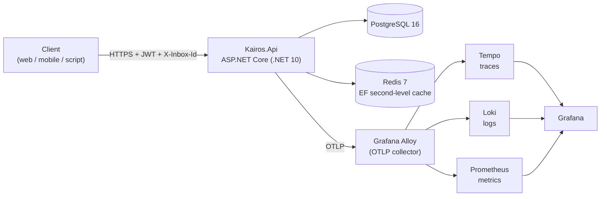

Kairos has no outbound business integrations: its only external dependencies are PostgreSQL (system of record), Redis (cache) and the OTLP collector (telemetry).

## 3. Solution Layout

```
Kairos.sln
├── src/Kairos.Api                  # The application
├── tests/Kairos.Tests              # Unit tests
├── tests/Kairos.IntegrationTests   # End-to-end tests (Testcontainers)
└── observability/                  # Alloy, Tempo, Loki, Prometheus, Grafana configs
```

Inside `src/Kairos.Api`:

```
Kairos.Api/
├── Program.cs                 # Composition root + middleware pipeline
├── Common/                    # Shared kernel (no dependency on Modules)
│   ├── Base/                  # BaseModel, BaseDTO, BaseFilter, repository base, ISeedCase
│   ├── Result/                # Result<T>
│   ├── Page/                  # Page<T>
│   ├── Res/                   # ResponseHttp<T>, ValidationErrorResponse
│   ├── Enums/                 # Status and type enums
│   ├── Exceptions/            # Unexpected-failure exceptions
│   └── Middleware/            # RequireInboxIdMiddleware
├── Config/                    # Infrastructure and cross-cutting concerns
│   ├── DB/                    # AppDbContext, DI, migrations, transaction use cases
│   ├── UnitOfWork/            # IUnitOfWork + implementation
│   ├── Authentication/        # JWT, [RequirePermissions], policy provider + handler
│   ├── Bootstrap/             # Startup seed orchestration
│   ├── Observability/         # OpenTelemetry, Serilog sink, custom metrics
│   ├── Health/                # PostgreSQL and Redis health checks
│   ├── Swagger/ Version/ Cors/ ApiBehavior/ Options/ Contracts/
│   └── ConfigModule.cs        # Registers all of the above
└── Modules/                   # Business features (see next section)
```

## 4. Modular Monolith

### 4.1 Modules

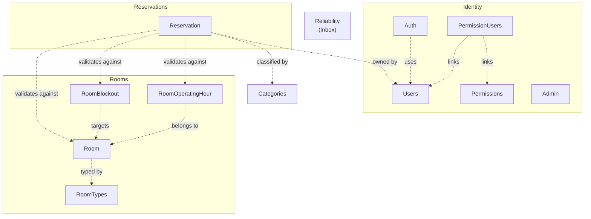

Each module exposes a single DI entry point, called from `Program.cs`:

```csharp
builder.Services
    .AddRoomsModule()
    .AddReservationsModule()
    .AddCategoriesModule()
    .AddConfigModule()
    .AddReliabilityModule()
    .AddAuthModule();       // Identity
```

A module's `Add<X>Module()` registers its repositories and use cases (grouped as *Queries* and *Commands*), keeping `Program.cs` free of feature details.

### 4.2 Feature folder convention

Every feature follows the same internal layout, which makes any feature navigable without reading its code first:

| Folder | Responsibility |
| --- | --- |
| `Controllers/` | HTTP surface: routing, permission attributes, response envelope |
| `DTOs/Request` | Payloads and query filters received from clients |
| `DTOs/Response` | Payloads returned to clients |
| `DTOs/Commands` | Internal inputs that combine request data with server-side context (e.g. authenticated user id) |
| `Models/` | EF Core entities |
| `Configurations/` | `IEntityTypeConfiguration<T>` (table, columns, indexes, constraints) |
| `Repositories/` | Data access (interface + implementation) |
| `Services/Interfaces` and `Services/Providers` | Use case contracts and implementations |
| `Mapper/` | Model ↔ DTO mapping |
| `Seed/` (when applicable) | Startup data seeding |

### 4.3 Boundaries

Module boundaries are enforced by **convention and folder structure**, not by separate assemblies. Use cases from one module may read another module's data through the shared `IUnitOfWork` (for example, `CreateReservationUseCase` reads rooms, categories, operating hours and blockouts). This is a deliberate simplification discussed in [section 15](#15-design-trade-offs-and-future-work).

## 5. Request Pipeline

The order of the middleware in `Program.cs` is significant:

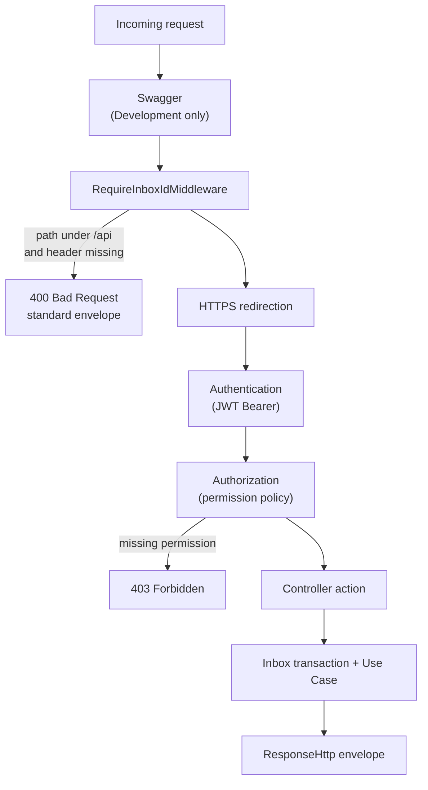

Notes:

- `RequireInboxIdMiddleware` runs **before** authentication, so a request without `X-Inbox-Id` is rejected with `400` even if it is also unauthenticated. `OPTIONS` (CORS preflight) requests and paths outside `/api` (such as `/health` and `/swagger`) are exempt.
- Health endpoints (`/health`, `/health/ready`, `/health/live`) are mapped after the pipeline and are anonymous.
- API versioning is URL-based (`/api/v1/...`) through `Asp.Versioning`.

## 6. Core Building Blocks

### 6.1 Use Case

Each business operation is a class implementing an interface of the form `IUseCase<TInput, Result<TValue>>`:

```csharp
public interface ICreateReservationUseCase
    : IUseCase<CreateReservationCommand, Result<ReservationModel>> { }
```

A use case:

1. validates input (data annotations plus explicit rules),
2. loads what it needs through `IUnitOfWork`,
3. applies business rules,
4. mutates tracked entities and returns a `Result<T>`.

It does **not** open transactions or call `SaveChanges`; that is the wrapper's job (see section 7). This keeps use cases small and easy to unit test with a mocked `IUnitOfWork`.

### 6.2 Result pattern

`Result<T>` carries either a value or a non-empty list of errors, together with an HTTP status code:

```csharp
Result<ReservationModel>.Created(reservation);                 // 201
Result<ReservationModel>.NotFound("Room doesn't exist.");      // 404
Result<ReservationModel>.Conflict("Room is blocked ...");      // 409
Result<ReservationModel>.ValidationFailure(errors);            // 400
```

Its constructor enforces invariants (a success must use a 2xx code and carry no errors; a failure must use a non-2xx code and carry at least one error), so an inconsistent result cannot be built. Controllers translate a failed `Result` directly into the response using `result.StatusCode` and `result.Errors`, which avoids exception-driven control flow for expected business outcomes.

### 6.3 Unit of Work

`IUnitOfWork` is the single access point to all repositories and to transaction handling:

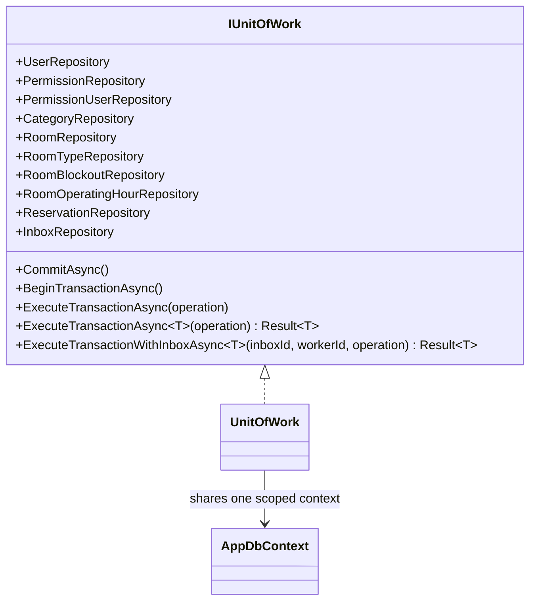

All repositories and the unit of work share the **same scoped `AppDbContext`**, so changes made by different repositories inside one request are persisted together by a single `SaveChanges`.

### 6.4 Repositories

Repositories derive from a generic `BaseRepositoryImpl<T>` (basic add/get/update/delete) and add feature-specific queries, for example `ReservationRepository.ExistsConflictingByRoomAsync` or `InboxRepository.TryMarkAsProcessingAsync`. List queries build an `IQueryable` incrementally from a filter DTO, apply pagination and use deterministic ordering (`StartsAt`, then `Id`) so pages are stable.

### 6.5 Response envelope and pagination

All controllers return `ResponseHttp<T>` (data, message, trace id, success flag, timestamp, errors). Lists are returned as `Page<T>`, which exposes total count, total pages and navigation flags. `BaseFilter` standardizes pagination (`Page ≥ 1`, `PageSize` 1–100) and cross-field validation (for example `CreatedAtMin ≤ CreatedAtMax`).

## 7. Transactions and the Inbox Pattern

### 7.1 Why an Inbox

HTTP clients retry. Networks fail between "request executed" and "response received". Without protection, a retried `POST /reservations` could run twice. The Inbox pattern makes each request carry a unique **inbox id** (`X-Inbox-Id`) that identifies a row in the `InboxMessages` table; the row can be *claimed* by exactly one worker, so the operation is executed at most once.

### 7.2 Layers of transaction handling

| Wrapper | Used for | Behavior |
| --- | --- | --- |
| `TransactionUseCase<,,>` | Operations that only need a transaction | `ExecuteTransactionAsync` |
| `InboxTransactionUseCase<,,>` | Operations protected by the Inbox | `ExecuteTransactionWithInboxAsync` |

Both are open-generic decorators registered once in `ConfigModule`, so **any** use case gains transactional (and Inbox) behavior without modification:

```csharp
IInboxTransactionUseCase<CreateReservationCommand, ReservationModel, ICreateReservationUseCase>
```

Controllers receive the decorated use case and call `ExecuteAsync(inboxId, workerId, input, ct)`, where `workerId` is `http-<guid>` identifying the processing instance.

### 7.3 Sequence of an Inbox-protected operation

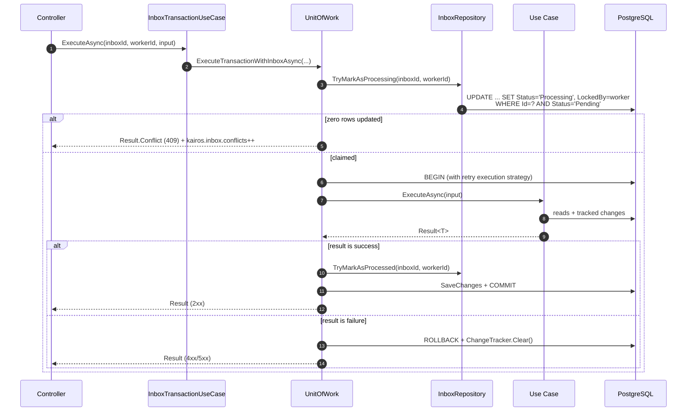

Key points:

- **Claiming is a single atomic SQL `UPDATE`** (`ExecuteUpdateAsync`) guarded by `Status = Pending` and `NextAttemptAt` being null or due. Concurrent requests with the same inbox id cannot both succeed.
- Marking the message `Processed` happens **inside** the business transaction, so the effect of the operation and the "done" marker commit or roll back together.
- A `Result` failure causes an explicit rollback and clears the change tracker, so a half-built entity never leaks into later work on the same context.
- The whole transactional block runs inside an EF **execution strategy** (`EnableRetryOnFailure`), so transient database errors are retried transparently.
- `ExecuteTransactionAsync` is **re-entrant**: if a transaction is already open it simply runs the operation inside it. The Inbox variant, in contrast, refuses to run inside an existing transaction (it throws `InvalidOperationException`).

### 7.4 Inbox lifecycle

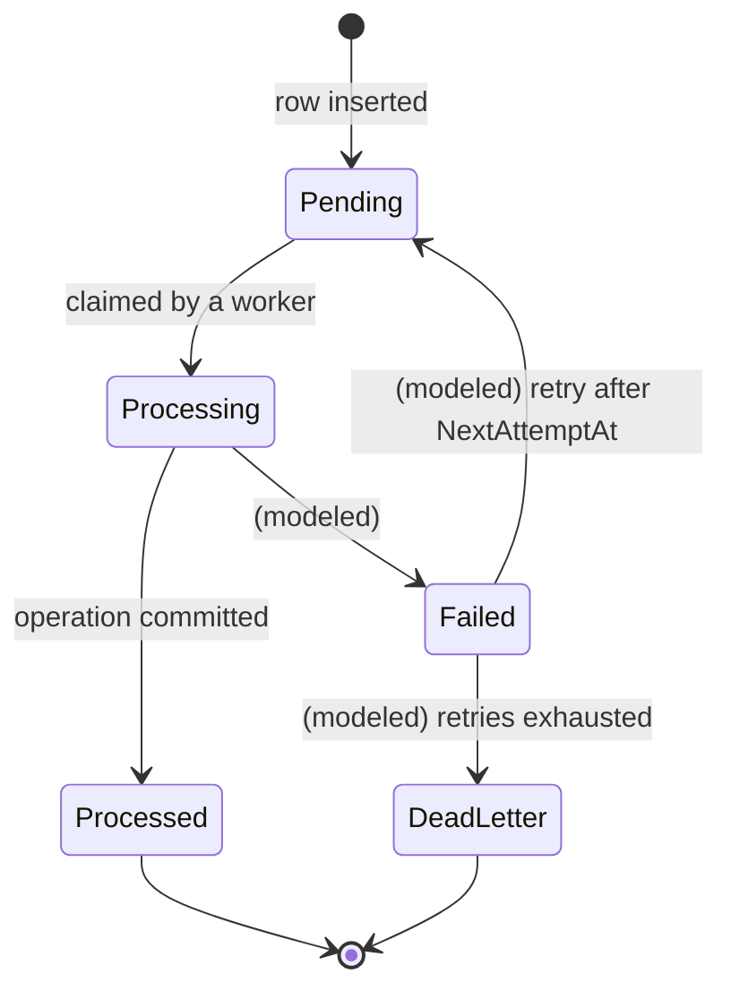

`Failed`, `DeadLetter`, `RetryCount`, `NextAttemptAt` and `LastError` exist in the data model, but in the code path reviewed only the `Pending → Processing → Processed` transitions are implemented. See [section 15](#15-design-trade-offs-and-future-work).

### 7.5 Operations that bypass the Inbox transaction

Some read operations (for example listing rooms, room types and categories, or finding a blockout by id) call their use case directly rather than through the Inbox wrapper. They are still subject to `RequireInboxIdMiddleware`, which requires the header on every `/api` request, but they do not consume the inbox row.

## 8. Persistence

### 8.1 AppDbContext

`AppDbContext` extends `IdentityDbContext<UserModel>`, so ASP.NET Core Identity tables live in the same database as the domain tables (renamed with an `app_` prefix, for example `app_roles`, `app_user_claims`). Entity mappings are discovered automatically with `ApplyConfigurationsFromAssembly`, so adding an `IEntityTypeConfiguration<T>` is enough to register a new entity.

### 8.2 Audit and optimistic versioning

`SaveChanges` is overridden to maintain audit columns for every entity derived from `BaseModel` (and for `UserModel`):

| Entity state | Effect |
| --- | --- |
| `Added` | `CreatedAt = now`, `Version = 1` |
| `Modified` | `UpdatedAt = now`, `Version++` |

Business code therefore never sets these fields manually, and every row carries a monotonically increasing `Version`.

### 8.3 Data integrity in the database

Rules are enforced in code **and** in the schema where it matters:

- `ck_reservations_valid_period` (`starts_at < ends_at`) check constraint.
- `ix_reservations_room_period` index on `(room_id, starts_at, ends_at)` to serve the overlap query.
- `ux_reservations_user_idempotency_key`: a **partial unique index** on `(user_id, idempotency_key)` where the key is not null.
- `DeleteBehavior.Restrict` on reservation foreign keys, so rooms, users or categories that have reservations cannot be silently removed.
- Unique index on `InboxMessages.MessageId`; status stored as readable strings.

### 8.4 Caching and locking

- **EF Core Second Level Cache** (`EFCoreSecondLevelCacheInterceptor`) stores query results in **Redis**, with a configurable prefix and expiration (default 5 minutes). If Redis is unavailable the interceptor falls back to the database (`UseDbCallsIfCachingProviderIsDown`), so the cache is an optimization, not a hard dependency for correctness.
- **`EntityFrameworkCore.Locking.PostgreSQL`** adds row-level locking support to the context, toggled by `Postgres:EnableLocking`.
- **Resilience:** Npgsql retry-on-failure with configurable retry count, delay and command timeout.

### 8.5 Migrations

Migrations live in `Config/DB/Migrations` and are applied automatically at startup with `Database.MigrateAsync()`.

## 9. Authentication and Authorization

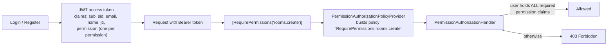

- **Permission-based, not role-based.** Authorization checks `permission` claims embedded in the JWT. A user's permission set is stored on the user record and copied into the token at login or refresh.
- **Dynamic policies.** `[RequirePermissions("a", "b")]` produces a policy name at compile time; a custom `IAuthorizationPolicyProvider` materializes the policy on demand, so no policy has to be pre-registered per permission. The handler requires **all** listed permissions (case-insensitive).
- **Identity extraction.** Controllers read the acting user from `sid` (falling back to `sub`) and place it in the command (`CreatedBy`, `CancelledBy`, `UserId`). Clients can never impersonate another user through the request body.
- **Master user.** Seeded at startup from configuration and automatically linked to every known permission.
- **Account protection.** Three consecutive failed logins lock an account for five hours; inactive accounts cannot log in; deactivation revokes the refresh token.

## 10. Application Bootstrap

After the host is built and before it starts serving traffic, `Program.cs` creates a scope and runs database setup:

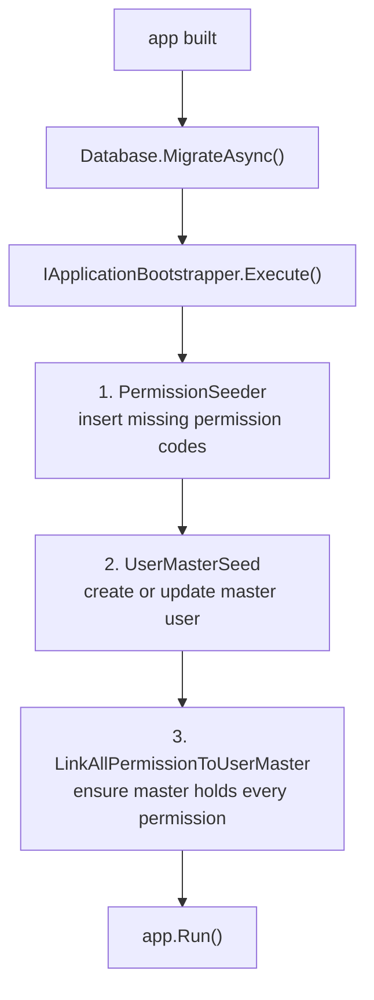

- Seeds implement `ISeedCase` and are executed **in registration order** by `ApplicationBootstrapper`, which logs each step with duration and position.
- Every seed is **idempotent**: it checks existence first, so restarting the application never duplicates data and new permissions added in later versions are picked up automatically.
- A failure in any seed aborts startup with an `ApplicationBootstrapperException` that records the failing seed, stage and elapsed time.

## 11. State Machines

### Reservation

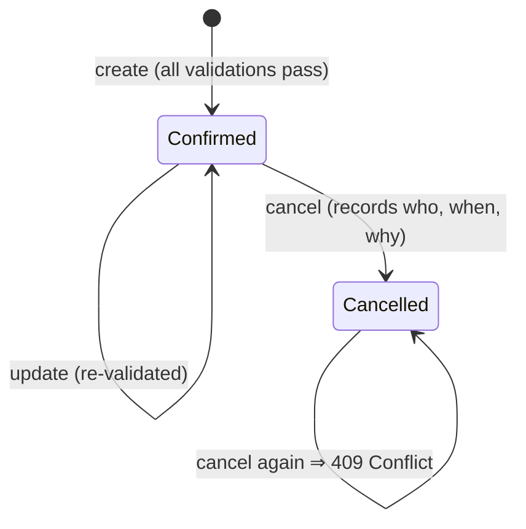

Cancelled reservations are ignored by conflict detection, so the time slot becomes available again.

### Room blockout

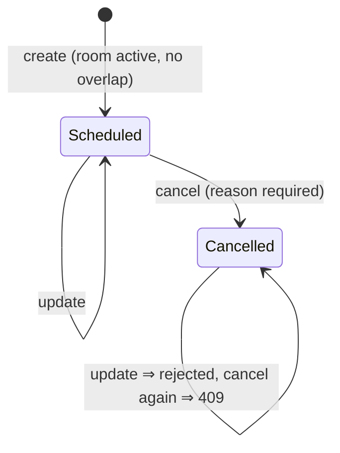

### Reservation creation flow

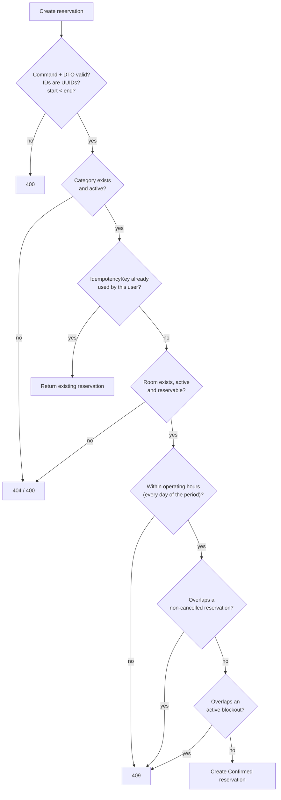

Two overlap checks use the standard interval predicate `existing.StartsAt < requested.EndsAt AND existing.EndsAt > requested.StartsAt`, so back-to-back reservations (one ending exactly when the next begins) do not conflict.

## 12. Observability

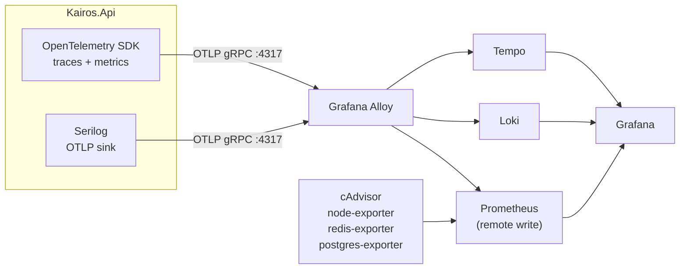

- **One resource identity** (`service.name`, namespace, version, instance, environment) is shared by traces, metrics and logs so everything correlates in Grafana.
- **Traces:** ASP.NET Core, HttpClient, Npgsql (one span per SQL command) and Redis instrumentation, plus a custom `inbox.transaction` span tagged with inbox id, worker id and outcome. Only `5xx` outcomes mark a span as an error, since `4xx` results are expected business outcomes.
- **Metrics:** ASP.NET Core, runtime, Npgsql, HttpClient, and the custom counter `kairos.inbox.conflicts`.
- **Enrichment:** each request span carries `kairos.inbox.id` and `enduser.id`.
- **Noise reduction:** `/health`, `/swagger` and `/favicon.ico` are excluded from tracing.
- **Safe in tests:** telemetry export is disabled in the `Testing` environment.
- **Health checks:** `/health` (all), `/health/ready` (PostgreSQL + Redis) and `/health/live` (process only), mapping directly to Kubernetes-style readiness and liveness probes.

## 13. Testing Architecture

| Layer | Project | Strategy |
| --- | --- | --- |
| Use cases and seeds | `Kairos.Tests` | Fast unit tests; `IUnitOfWork` and repositories mocked (Moq / NSubstitute); Bogus for data; Shouldly / FluentAssertions for assertions |
| HTTP flows | `Kairos.IntegrationTests` | `WebApplicationFactory<Program>` in the `Testing` environment, backed by **real PostgreSQL 16 and Redis 7 containers** (Testcontainers) |

The integration factory replaces the `DbContext` and Redis multiplexer with container-backed instances while keeping the production second-level cache interceptor, so tests exercise the real pipeline: middleware, JWT, permissions, Inbox, transactions and the schema. A shared `BaseIntegrationTest` provides helpers to create inbox rows, register users, obtain tokens and create domain entities, and cache is flushed between tests to avoid stale reads. `Program` is exposed as `public partial class Program` specifically so the test host can bootstrap it.

## 14. Adding a New Feature

To add an operation or a whole feature that follows the existing conventions:

1. **Model and mapping**: create the entity (inherit `BaseModel`) in `Models/` and its `IEntityTypeConfiguration<T>` in `Configurations/`. It is picked up automatically. Add a `DbSet<T>` to `AppDbContext` and generate a migration.
2. **Repository**: define `IXRepository` and an implementation deriving from `BaseRepositoryImpl<T>`; expose it on `IUnitOfWork` / `UnitOfWork`.
3. **Use case**: add `IDoSomethingUseCase : IUseCase<TInput, Result<TOutput>>` in `Services/Interfaces` and the implementation in `Services/Providers`. Validate input, apply rules, return a `Result`.
4. **DTOs and mapper**: request/response DTOs, an internal command when server-side context (e.g. user id) is needed, and a mapper.
5. **Controller action**: inject `IInboxTransactionUseCase<TInput, TOutput, IDoSomethingUseCase>`, require the `X-Inbox-Id` header, add `[RequirePermissions("x.action")]`, and return the standard `ResponseHttp<T>`.
6. **DI**: register the repository and use case in the module's `Add<X>Module()`.
7. **Permission**: add the code to `PermissionSeeder`; the master user receives it on next startup.
8. **Tests**: a unit test for the use case and an integration test for the endpoint.

## 15. Design Trade-offs and Future Work

**Deliberate trade-offs**

- **Modular monolith over microservices.** One deployable, one database, simple transactions across modules. The cost is that module boundaries are conventions rather than compiler-enforced.
- **Central `IUnitOfWork` exposing every repository.** Convenient and consistent, but every use case can reach every module's data, and `UnitOfWork` depends on all repositories. A stricter design would give each module its own narrow port.
- **Permissions in the JWT.** Authorization needs no database lookup per request, but permission changes only take effect after the user obtains a new token (or the token expires).
- **Result pattern instead of exceptions** for business errors: explicit and cheap, at the price of repetitive failure-to-response translation in controllers.
- **Second-level cache with a short TTL.** Reduces read load with bounded staleness, and degrades gracefully when Redis is down.

**Known gaps and planned work**

- **Inbox failure handling.** Claiming happens outside the business transaction (it is committed immediately), and when an operation returns a failed `Result` the transaction rolls back but the message is left in `Processing`. The `Failed`/`DeadLetter` states, retry scheduling (`RetryCount`, `NextAttemptAt`) and `LastError` recording are modeled but not yet driven by code, and an earlier draft of this logic is left commented out in `UnitOfWork`. A recovery strategy for messages stuck in `Processing` is also needed.
- **No endpoint to create inbox messages.** Clients currently cannot obtain an inbox id through the API; the `Reliability/Inbox/Controller` folder is a placeholder.
- **Outbox.** The Inbox covers inbound idempotency; an Outbox for reliable outbound events is planned (an empty `Outbox` folder exists).
- **Reservation extras.** Attendees, history/audit entries and check-in/check-out have permission codes or columns but no endpoints yet.
- **Concurrency on overlapping reservations.** Overlap detection is a check-then-insert inside a transaction. Under heavy concurrency on the same room, a database-level exclusion constraint (PostgreSQL `EXCLUDE USING gist` on a time range) would make double-booking impossible regardless of application logic.