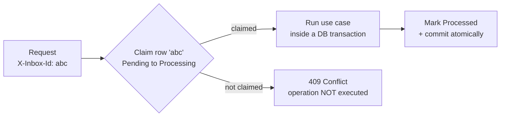
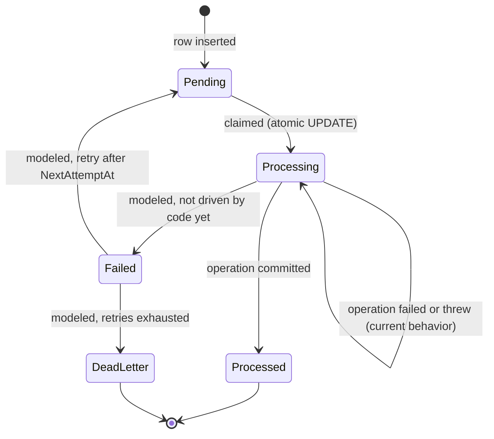
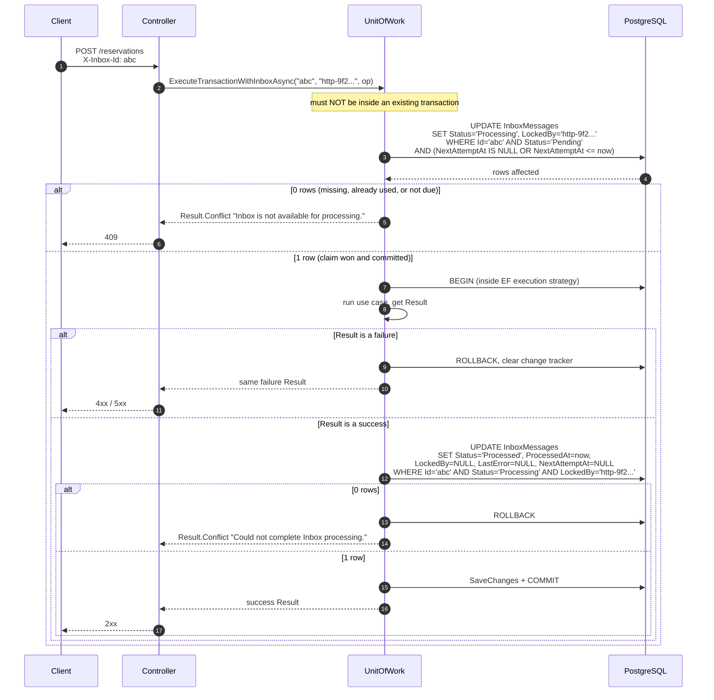
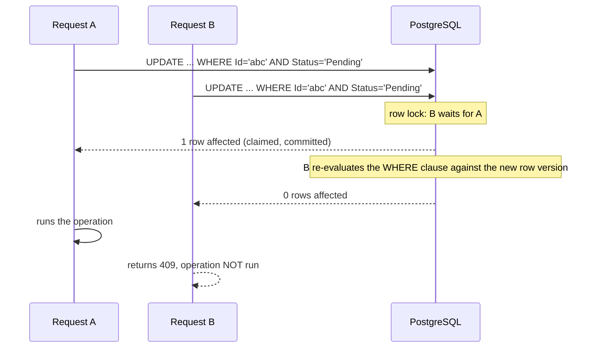

# The Inbox Pattern in Kairos

This document describes how Kairos uses the **Inbox pattern** to make API operations safe to retry, how the `X-Inbox-Id` header works end to end, what happens in every success and failure scenario, and which parts are still work in progress. For the high-level design see [architecture.md](./architecture.md); for setup see the [README](../README.md).

## Table of Contents

1. [The problem](#1-the-problem)
2. [The idea](#2-the-idea)
3. [Data model](#3-data-model)
4. [Lifecycle](#4-lifecycle)
5. [How a request is processed](#5-how-a-request-is-processed)
6. [Outcome reference](#6-outcome-reference)
7. [Concurrency guarantees](#7-concurrency-guarantees)
8. [Client guide](#8-client-guide)
9. [Where the Inbox is applied](#9-where-the-inbox-is-applied)
10. [Observability](#10-observability)
11. [Testing](#11-testing)
12. [Operating the Inbox](#12-operating-the-inbox)
13. [Limitations and roadmap](#13-limitations-and-roadmap)
14. [FAQ](#14-faq)

---

## 1. The problem

HTTP is unreliable in a specific, nasty way: a client can send a request, the server can execute it, and the response can still be lost. The client cannot tell "never executed" from "executed but I did not hear back", so it retries. Without protection, a retried `POST /reservations` or `POST /auth/Register` runs twice.

Double execution is a correctness bug for a booking system, so Kairos treats **"this exact request was already handled"** as something the system must be able to detect, atomically, in the database.

## 2. The idea

Every request under `/api` carries an **inbox id** in the `X-Inbox-Id` header. The id points to a row in the `InboxMessages` table. Before running the business logic, the API tries to **claim** that row with a single atomic `UPDATE` that only succeeds if the row is still `Pending`. Whoever wins the claim runs the operation; everyone else gets `409 Conflict`.



What the Inbox **is** in Kairos:

- a per-request **execution token** that can be consumed at most once;
- a durable record (status, worker, timestamps) of whether that token was used;
- a building block that can later support retries, dead-lettering and background workers.

What it **is not** (today):

- It does **not** store or replay the original response. A second request with a consumed id is rejected, not answered with the first result.
- It does **not** deduplicate by request content. Two different inbox ids carrying the same payload are two different requests.
- It is **not** a message-queue consumer: clients create inbox rows (see [section 8](#8-client-guide)); no background worker drains them yet.

## 3. Data model

Table `InboxMessages` (entity `InboxModel`, derived from `BaseModel`):

| Column | Type | Purpose |
| --- | --- | --- |
| `Id` | text (PK) | The value clients send in `X-Inbox-Id` |
| `MessageId` | varchar(256), **unique** | Business or upstream message identifier; prevents two inbox rows for the same logical message |
| `MessageType` | varchar(256) | Kind of message (for example `auth.register`) |
| `Payload` | jsonb | Message body |
| `Source` | varchar(256), nullable | Origin of the message |
| `Headers` | jsonb, nullable | Extra metadata |
| `Status` | varchar(32) | `Pending`, `Processing`, `Processed`, `Failed`, `DeadLetter` (stored as text) |
| `ReceivedAt` | timestamptz | When the message was received |
| `ProcessedAt` | timestamptz, nullable | When processing completed |
| `RetryCount` | int, default 0 | Number of retry attempts (modeled) |
| `NextAttemptAt` | timestamptz, nullable | Earliest time the message may be claimed (modeled for retry scheduling) |
| `LastError` | text, nullable | Last failure description (modeled) |
| `LockedBy` | varchar(256), nullable | Worker that currently holds the message |
| `CorrelationId` | varchar(256), nullable | Groups related messages |
| `Version`, `CreatedAt`, `UpdatedAt` | | Standard audit columns |

`LockedBy` stores the **worker id**, which for HTTP requests is `http-<guid>`: a fresh value per request. It identifies *the request that holds the claim*, not a long-lived process.

## 4. Lifecycle



| Transition | Status |
| --- | --- |
| `Pending → Processing` | Implemented (`TryMarkAsProcessingAsync`) |
| `Processing → Processed` | Implemented (`TryMarkAsProcessedAsync`) |
| `Processing → Failed / Pending / DeadLetter` | Modeled (enum values and columns exist) but not implemented in the request path |

## 5. How a request is processed

### 5.1 Entry: the middleware

`RequireInboxIdMiddleware` runs before authentication. For any path starting with `/api` (except CORS `OPTIONS` preflights), a missing or blank `X-Inbox-Id` header yields an immediate **`400 Bad Request`** in the standard response envelope. Paths outside `/api`, such as `/health` and `/swagger`, are not affected.

The middleware only checks that the header is **present**. Whether the id refers to a real, claimable row is decided later, when an Inbox-protected use case runs.

### 5.2 Controller to Unit of Work

Controllers inject the decorated use case and call it with the header value and a per-request worker id:

```csharp
string workerId = $"http-{Guid.NewGuid():N}";

Result<ReservationModel> result =
    await createReservationUseCase.ExecuteAsync(inboxId, workerId, command, ct);
```

`InboxTransactionUseCase<TInput, TValue, TUseCase>` forwards to `UnitOfWork.ExecuteTransactionWithInboxAsync`, which wraps **any** use case without modifying it.

### 5.3 The sequence



### 5.4 Important details

- **The claim is committed immediately.** `ExecuteUpdateAsync` runs as its own statement, outside the business transaction. This is why the method refuses to run inside an existing transaction (it throws `InvalidOperationException`): the claim must be durable and visible to other requests the instant it happens.
- **"Processed" commits with the business changes.** The second `UPDATE` runs *inside* the business transaction. If the use case's changes roll back, the `Processed` marker rolls back with them, and vice versa; they can never disagree.
- **The processed marker is ownership-checked.** It only applies if `Status = Processing` **and** `LockedBy` equals this request's worker id, so a request cannot complete a message that another worker holds.
- **Transient failures are retried transparently.** The transactional block runs inside an EF Core execution strategy (`EnableRetryOnFailure`). On a transient database error the whole block (transaction, use case and processed marker) is re-run; the claim, being outside the block, is not repeated.
- **A failed `Result` clears the change tracker**, so partially built entities from the failed attempt cannot leak into later work on the same `DbContext`.
- **Failed business results keep their own status code.** A `404` from the use case is returned as a `404`, not converted into a `409`.

## 6. Outcome reference

| Scenario | HTTP result | Inbox row afterwards |
| --- | --- | --- |
| `X-Inbox-Id` header missing or blank | `400` (middleware) | Untouched |
| Id does not match any row | `409` "Inbox is not available for processing." | n/a |
| Row is `Processing` or `Processed` | `409` | Unchanged |
| Row is `Pending` but `NextAttemptAt` is in the future | `409` | Unchanged |
| Claimed, use case succeeds | `2xx` | `Processed`, `ProcessedAt` set, `LockedBy` cleared |
| Claimed, use case returns a failure (`400`/`404`/`409`...) | The use case's own status | **`Processing`**, `LockedBy` still set (current behavior) |
| Claimed, use case throws an exception | `500` | **`Processing`**; span marked as error |
| Claimed, use case succeeds, but the processed marker cannot be applied | `409` "Could not complete Inbox processing." | Business transaction rolled back |
| Transient database error during the transaction | Usually the final result of the retried attempt | Claim is not repeated |

> **Note a missing id returns `409`, not `404`.** From the claim's perspective "no such row" and "row not claimable" are indistinguishable: both update zero rows.

The two rows in bold are the consequence of the current design discussed in [section 13](#13-limitations-and-roadmap): **a claimed inbox id is consumed even if the operation fails.** Clients must use a fresh id for the next attempt.

## 7. Concurrency guarantees

**Two requests, same inbox id, at the same time.**



PostgreSQL serializes the two `UPDATE`s on the same row. Under the default `READ COMMITTED` isolation, the waiting statement re-checks its `WHERE` clause after the first commits; it now sees `Status = 'Processing'` and matches nothing. Exactly one request proceeds.

This guarantee holds **per inbox id**. It does *not* prevent two *different* requests (different inbox ids) from racing on the same business resource, such as two users booking the same room slot at once. That is a separate concern handled by the overlap checks inside the transaction (and discussed in [architecture.md, section 15](./architecture.md#15-design-trade-offs-and-future-work)).

## 8. Client guide

### 8.1 Getting an inbox id (current state)

Kairos does **not yet expose an endpoint to create inbox messages**. The `Inbox` module contains use cases and DTOs for creating and marking messages, but they are not registered in `ReliabilityModule` and no controller exposes them. Today an inbox row has to be created directly in the database (this is also what the integration tests do through `AppDbContext`).

Create one row:

```sql
INSERT INTO "InboxMessages"
  ("Id", "MessageId", "MessageType", "Payload", "Status",
   "ReceivedAt", "RetryCount", "Version", "CreatedAt")
VALUES
  (gen_random_uuid()::text,
   'message-' || gen_random_uuid()::text,
   'manual.test',
   '{"value":"manual"}',
   'Pending',
   now(), 0, 1, now())
RETURNING "Id";
```

Create a batch of 20 ids for a testing session:

```sql
INSERT INTO "InboxMessages"
  ("Id", "MessageId", "MessageType", "Payload", "Status",
   "ReceivedAt", "RetryCount", "Version", "CreatedAt")
SELECT
  gen_random_uuid()::text,
  'message-' || gen_random_uuid()::text,
  'manual.test',
  '{"value":"manual"}',
  'Pending',
  now(), 0, 1, now()
FROM generate_series(1, 20)
RETURNING "Id";
```

### 8.2 Rules of thumb

1. **One inbox id per logical operation attempt.** Never reuse an id across different calls.
2. **Send the header on every `/api` call**, including anonymous ones (`Login`, `Register`, `RefreshToken`, the `Exists` checks) and plain reads. Only the health and Swagger endpoints are exempt.
3. **Treat `409` on an Inbox-protected call as "this id cannot be used"**, not necessarily as "the operation failed". Look at the response `message` and `errors`.

### 8.3 Retrying safely

Because the Inbox does not replay responses, retry logic needs a little care:

| Situation | Recommended client behavior |
| --- | --- |
| Request failed validation (`400`) or a business rule (`404`/`409`) | Fix the cause and retry with a **new** inbox id |
| Response was lost (timeout, dropped connection) | **Do not** resend with the same id: you will get `409` and not learn the outcome. Query the resource (for example `GET /reservations/{id}` or filter by title/period) or retry with a **new** id plus the business idempotency key below |
| Server error (`5xx`) | Retry with a **new** inbox id |

For reservations, combine both layers of protection:

| Layer | Scope | Protects against |
| --- | --- | --- |
| **Inbox id** (`X-Inbox-Id`) | One *request attempt* | The same request being executed twice (duplicate delivery, accidental double submit) |
| **`IdempotencyKey`** on `CreateReservationDto` | One *business intention* per user | A retried "create" (even with a new inbox id) creating a second reservation: the existing one is returned instead |

Example: a retry after a lost response, with a **new inbox id** and the **same idempotency key**:

```bash
# First attempt (response lost)
curl -X POST http://localhost:5093/api/v1/reservations \
  -H "Authorization: Bearer <token>" \
  -H "X-Inbox-Id: <inbox-id-1>" \
  -H "Content-Type: application/json" \
  -d '{ "roomId": "<room>", "categoryId": "<category>", "title": "Sprint planning",
        "startsAt": "2026-11-10T09:00:00-03:00", "endsAt": "2026-11-10T10:30:00-03:00",
        "idempotencyKey": "sprint-12-planning" }'

# Retry: new inbox id, same idempotency key, returns the reservation created before
curl -X POST http://localhost:5093/api/v1/reservations \
  -H "Authorization: Bearer <token>" \
  -H "X-Inbox-Id: <inbox-id-2>" \
  -H "Content-Type: application/json" \
  -d '{ "roomId": "<room>", "categoryId": "<category>", "title": "Sprint planning",
        "startsAt": "2026-11-10T09:00:00-03:00", "endsAt": "2026-11-10T10:30:00-03:00",
        "idempotencyKey": "sprint-12-planning" }'
```

## 9. Where the Inbox is applied

Operations are wired in one of two ways:

| Style | Controller dependency | Consumes the inbox row |
| --- | --- | --- |
| **Inbox-protected** | `IInboxTransactionUseCase<TInput, TValue, TUseCase>` | Yes (claim, transaction, processed marker) |
| **Direct** | The use case interface itself (for example `IFindAllRoomUseCase`) | No |

All **mutations** (create, update, cancel, delete, status changes) and all **Auth endpoints** are Inbox-protected, as are most single-item reads and existence checks. A few list and lookup operations call their use case directly, for example listing rooms, room types and categories, the category existence checks, and finding a blockout by id.

Direct operations still require the header (the middleware does not distinguish), but they neither validate nor consume the row.

> To see the exact wiring for an endpoint, look at the controller's constructor: the `IInboxTransactionUseCase<...>` parameters are the protected operations.

## 10. Observability

Inbox processing is instrumented so conflicts and failures are visible without reading logs.

**Trace span.** Each Inbox-protected execution creates an `inbox.transaction` span (activity source `Kairos.Api`) tagged with:

| Tag | Value |
| --- | --- |
| `kairos.inbox.id` | The inbox id |
| `kairos.inbox.worker_id` | The worker id (`http-<guid>`) |
| `kairos.inbox.outcome` | `not_acquired`, `processed` or `failed` |
| `kairos.result.status_code` | The HTTP status of the resulting `Result` |

Only status codes **≥ 500** (and thrown exceptions) mark the span as an error. `4xx` results are expected business outcomes and do not turn spans red.

The incoming request span also carries `kairos.inbox.id` and `enduser.id`, so you can jump from an HTTP request to its Inbox span in Tempo.

**Metric.** `kairos.inbox.conflicts` (a counter) increments every time a message cannot be acquired. In Prometheus it is typically exposed as `kairos_inbox_conflicts_total` (verify the exact name in your Prometheus). A sustained rise usually means clients are retrying with consumed ids or a client bug is reusing ids.

Useful investigations in Grafana:

- *"Why did this request return 409?"* Search Tempo for the `kairos.inbox.id` and read `kairos.inbox.outcome`.
- *"Are clients retrying badly?"* Graph the rate of `kairos_inbox_conflicts_total`.

## 11. Testing

The integration tests exercise the Inbox for real, against PostgreSQL and Redis containers:

- `BaseIntegrationTest.CreateInboxAsync` inserts a `Pending` row through `AppDbContext`, and helpers such as `NewInboxAsync` give each test a fresh id.
- Tests send the id in `X-Inbox-Id`, then **read the row back** and assert that its `Status` became `Processed`, proving the claim and the processed marker both happened.
- Scenarios worth covering (and extending) include: missing header → `400`; unknown id → `409`; reusing a processed id → `409`; two concurrent requests with one id → exactly one success; a failing use case leaves the message `Processing`.

## 12. Operating the Inbox

Handy queries (PostgreSQL, quoted identifiers because the table uses PascalCase names):

```sql
-- Overview by status
SELECT "Status", count(*) FROM "InboxMessages" GROUP BY "Status";

-- Messages stuck in Processing for more than 10 minutes
SELECT "Id", "MessageType", "LockedBy", "UpdatedAt"
FROM "InboxMessages"
WHERE "Status" = 'Processing'
  AND "UpdatedAt" < now() - interval '10 minutes';
```

**Releasing a stuck message (development only).** Because failed operations currently leave messages in `Processing`, you may want to free one while testing. Only do this if you are certain the operation did **not** commit, otherwise you reopen the door to a duplicate execution:

```sql
UPDATE "InboxMessages"
SET "Status" = 'Pending', "LockedBy" = NULL
WHERE "Id" = '<inbox-id>' AND "Status" = 'Processing';
```

**Housekeeping.** Rows are never deleted by the application. In a long-running environment, plan a retention job, for example:

```sql
DELETE FROM "InboxMessages"
WHERE "Status" = 'Processed'
  AND "ProcessedAt" < now() - interval '30 days';
```

## 13. Limitations and roadmap

These are known, deliberate gaps in the current implementation:

| # | Limitation | Consequence | Direction |
| --- | --- | --- | --- |
| 1 | **No HTTP endpoint (or registered use case) creates inbox messages** | Clients cannot self-serve an inbox id; manual SQL is required | Add a `Reliability/Inbox` controller, or issue ids from a dedicated endpoint |
| 2 | **Failed operations leave the message in `Processing`** | The id is burned; the row looks "in flight" forever | Record failures: `Failed` with `LastError` for permanent errors (4xx), retry scheduling via `RetryCount`/`NextAttemptAt` for transient ones, `DeadLetter` after the retry budget |
| 3 | **No recovery for stale `Processing` rows** | A crash between claim and completion strands the message | Lease/timeout: let a message be re-claimed when `UpdatedAt` is older than a threshold |
| 4 | **No response replay** | A client that lost a response cannot recover the original result by resending | Persist the response (status + body) with the message and return it on duplicate ids |
| 5 | **Claim is outside the business transaction** | Needed for visibility, but it is the reason limitation 2 exists | The commented-out draft in `UnitOfWork.cs` explores claiming inside the transaction and recording failure afterwards |
| 6 | **No background worker** | `GetPendingAsync`, `GetByCorrelationIdAsync` and the retry columns are modeled for a poller that does not exist yet | A hosted service that processes `Pending` messages and applies the retry policy |
| 7 | **Unbounded table growth** | `InboxMessages` grows forever | Retention job (see section 12) |
| 8 | **Direct (non-Inbox) operations** | Inconsistent protection across read endpoints | Decide and document the rule: either protect all, or only mutations |

## 14. FAQ

**Why a database table instead of a cache like Redis?**
The claim must be atomic *and* tied to the business transaction's outcome. Using the same PostgreSQL database lets the "Processed" marker commit or roll back together with the business data, which a separate store cannot guarantee.

**Does the Inbox make my endpoints idempotent?**
It makes each *request attempt* execute at most once. Business-level idempotency (same intention retried with a new attempt) is a separate mechanism; for reservations that is the `IdempotencyKey`.

**Why is a read like `GET /reservations/{id}` Inbox-protected?**
Consistency of the contract: the same header is required everywhere under `/api`, and protected reads are traced end to end with the same identifiers. The cost is that each protected read consumes an id.

**Why `409` and not `404` for an unknown inbox id?**
The claim is a single conditional `UPDATE`; zero affected rows cannot tell "missing" from "already used". Distinguishing them would need an extra query, and the response would reveal whether a given id exists.

**Can I reuse an inbox id after a validation error (`400`)?**
No. In the current implementation the claim already happened, so the id is consumed. Use a new one.

**Is `workerId` a process or instance identifier?**
Not today. It is generated per request (`http-<guid>`) and identifies the claim holder for that request. It becomes meaningful as a long-lived worker identity once a background worker exists.